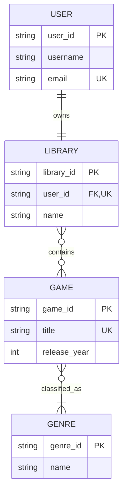

# Video Game Library — ER Modeling

## Project Overview

This project presents a conceptual entity-relationship (ER) model for a video game library system.

The system allows registered users to maintain personal libraries containing video games.

## Domain

The selected domain is a video game library system.

## Main Entities

- **User** — stores information about a registered user.
- **Library** — represents a personal library owned by one user.
- **Game** — stores information about a video game.
- **Genre** — describes a category to which games may belong.

## Relationships

- Each user owns exactly one personal library.
- A library can contain multiple games, and the same game can appear in multiple libraries.
- A game must belong to at least one genre, and a genre can classify multiple games.

## ER Diagram

## Technologies

- Mermaid — declarative ER modeling.
- JavaScript — validation scripts.
- Git — version control.